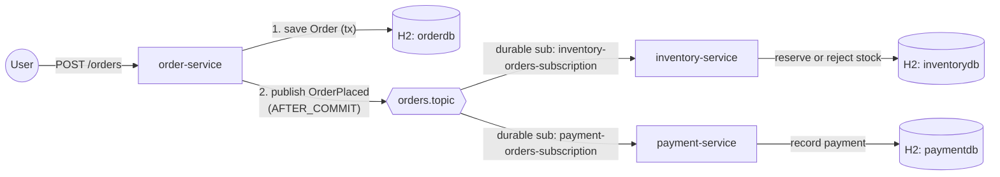

# order-placement-with-queue


A small order-placement POC built around ActiveMQ pub-sub: one producer, two independent durable
consumers, no shared JPA entities.

## What this POC demonstrates

- Decoupling producer and consumers on a wire contract (`order-contracts`) instead of a shared
  Boot application or JPA entity.
- Publishing a domain event only after the originating transaction commits
  (`@TransactionalEventListener(phase = AFTER_COMMIT)`), and the dual-write gap that still leaves.
- Durable topic subscriptions so a consumer that is offline when a message is published still gets
  it on restart.
- Idempotent message consumers (unique constraint + existence check) so JMS at-least-once delivery
  doesn't double-reserve stock or double-charge a payment.
- A JMS message converter keyed by a logical type id, so producer and consumers never need each
  other's fully-qualified class names on the wire.



## Tech stack

| Component       | Version                         |
|-----------------|----------------------------------|
| Java            | 21                               |
| Spring Boot     | 4.1.1                            |
| Spring Framework| 7.0.9                            |
| Jackson         | 3.1.5 (`tools.jackson.*`)        |
| ActiveMQ Classic| 6.2.9 (client/broker), 6.2.0 image |
| H2              | runtime-managed by Boot BOM      |
| Thymeleaf       | runtime-managed by Boot BOM      |
| JUnit / Mockito / AssertJ / Awaitility | 5.x / 5.x / 3.x / 4.3.0 |

## Prerequisites

- JDK 21 (`.sdkmanrc` pins `21.0.10-tem`; `sdk env install` if using SDKMAN!).
- Maven Wrapper (`./mvnw`) — no local Maven install required.
- Docker + Docker Compose, only for running the full stack locally; the build and test suite do
  not require Docker.

## Build & test

```bash
# Full build: compile, unit tests, integration tests, JaCoCo report
./mvnw clean verify

# Unit tests only (fast, no JMS broker)
./mvnw test

# A single test class
./mvnw -pl order-service test -Dtest=OrderServiceTest

# Coverage report (per module, after `verify`)
open order-service/target/site/jacoco/index.html
```

## Run locally

### With the Maven Wrapper (requires a local or Dockerized ActiveMQ on `tcp://localhost:61616`)

```bash
docker run -p 61616:61616 -p 8161:8161 apache/activemq-classic:6.2.0

./mvnw -pl order-service -am spring-boot:run
./mvnw -pl inventory-service -am spring-boot:run
./mvnw -pl payment-service -am spring-boot:run
```

### With Docker Compose (broker + all three services)

```bash
docker compose up --build
```

| Service           | URL                          |
|--------------------|------------------------------|
| order-service      | http://localhost:8080/orders/new |
| inventory-service   | http://localhost:8081/        |
| payment-service    | http://localhost:8082/        |
| ActiveMQ console   | http://localhost:8161/ (admin/admin) |

## Configuration

| Env var                | Property                          | Default                                 | Purpose |
|-------------------------|------------------------------------|------------------------------------------|---------|
| `ACTIVEMQ_URL`          | `spring.activemq.broker-url`       | `tcp://localhost:61616`                   | Broker connection URL |
| `ACTIVEMQ_USER`         | `spring.activemq.user`             | `admin`                                   | Broker username |
| `ACTIVEMQ_PASSWORD`     | `spring.activemq.password`         | `admin`                                   | Broker password |
| `SERVER_PORT`           | `server.port`                      | `8080` / `8081` / `8082`                  | HTTP port per service |
| `ORDER_DB_URL`          | `spring.datasource.url`            | `jdbc:h2:mem:orderdb;...`                 | order-service datasource |
| `INVENTORY_DB_URL`      | `spring.datasource.url`            | `jdbc:h2:mem:inventorydb;...`             | inventory-service datasource |
| `PAYMENT_DB_URL`        | `spring.datasource.url`            | `jdbc:h2:mem:paymentdb;...`               | payment-service datasource |
| `INVENTORY_JMS_CLIENT_ID` | `spring.jms.client-id`           | `inventory-service`                       | Durable subscription client id |
| `PAYMENT_JMS_CLIENT_ID` | `spring.jms.client-id`             | `payment-service`                         | Durable subscription client id |

## Endpoints / UI

| Service           | Path                 | Method | Purpose |
|--------------------|-----------------------|--------|---------|
| order-service      | `/orders/new`         | GET    | Order form |
| order-service      | `/orders`             | POST   | Place an order (PRG, flash message with order id) |
| inventory-service   | `/`                   | GET    | Stock + reservations dashboard |
| payment-service    | `/`                   | GET    | Payments dashboard |
| all three          | `/actuator/health`    | GET    | Liveness/readiness |

## Project structure

```
order-contracts/    OrderPlaced record, destination/type-id constants, shared JMS converter
order-service/      Order form, OrderService (publish-after-commit), durable-unaware producer config
inventory-service/  Durable consumer: reserve/reject stock, idempotent on orderId
payment-service/    Durable consumer: record payment, idempotent on orderId
```

## Design notes & trade-offs

| Decision | Why | Trade-off |
|---|---|---|
| Shared `order-contracts` module instead of a shared JPA entity | Consumers shouldn't depend on the producer's persistence model or Boot app just to deserialize a message | One more module to version/release; still a compile-time coupling (on the message shape), just a much narrower one |
| Logical type id (`OrderPlaced` → class) instead of FQCN on the wire | Producer/consumer packages can diverge without breaking deserialization; keeps `packages.trust-all: false` safe | One more mapping to keep in sync when adding message types |
| Durable topic subscriptions (`client-id` + `@JmsListener(subscription=...)`) | Simple to reason about per-consumer-type delivery guarantees; built into core JMS/ActiveMQ | Requires `spring.jms.cache.enabled: false` (a durable subscriber needs a real, non-shared Connection to set its client id), so no connection caching/pooling |
| Alternative considered: ActiveMQ virtual topics (`VirtualTopic.orders` → `Consumer.<svc>.VirtualTopic.orders`) | Decouples consumer count from broker-side subscription bookkeeping, works with connection caching | More ActiveMQ-specific configuration (naming convention, broker-side virtual destination setup); not used here to keep the Spring-side JMS config portable |
| Publish via `@TransactionalEventListener(AFTER_COMMIT)` | Guarantees a message is never sent for an order that then rolls back | Still a dual write: DB commit and JMS send are two separate operations, so a crash between them loses the publish. A transactional outbox (persist the event in the same transaction, relay it with a poller) is the standard fix — not implemented here to keep the POC's scope on the JMS plumbing |
| Idempotent consumers via unique constraint on `order_id` | JMS is at-least-once; this makes redelivery after a crash/retry safe | Doesn't handle out-of-order delivery (not a concern for this single-topic design) |
| Inventory records a `REJECTED` reservation instead of silently dropping the order | Keeps a complete audit trail of what was rejected and why | No compensating action on payment: an order can still be paid for even if it's REJECTED for stock (see Known gaps) |

## Known gaps / next steps

- **Dual-write / outbox**: see the trade-off above. A transactional outbox table + relay (or
  Debezium-style CDC) removes the crash window between commit and publish.
- **No saga / compensation**: if inventory REJECTS an order, payment-service has no way to find out
  and still records a COMPLETED payment. A real system needs either a saga (inventory publishes a
  rejection event, payment compensates/refunds) or to reserve stock before accepting payment.
- **Compare with [orderplacementwithevents](https://github.com/natsaros7/orderplacementwithevents)**:
  the sibling repo solves the same domain with in-process Spring application events instead of a
  broker — no network hop or durable-subscription complexity, but no cross-process/cross-deployment
  decoupling either. This repo trades that simplicity for genuine service independence.
- **Broker alternatives**: Kafka would suit higher-throughput, replayable-log use cases (consumer
  groups instead of durable topic subscriptions); Artemis is a more actively developed JMS broker
  with a similar programming model to ActiveMQ Classic used here.
- **Redelivery / DLQ**: a redelivery policy (3 retries, exponential backoff) is configured on both
  consumers; messages that exhaust retries land on ActiveMQ's built-in `ActiveMQ.DLQ` queue, which
  isn't actively monitored or drained by this POC.

## License

[MIT](LICENSE)
