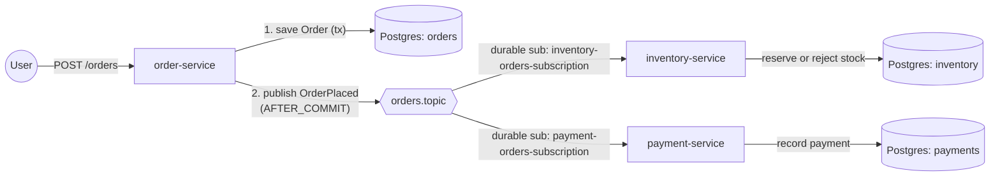

# order-placement-with-queue


A small order-placement POC built around ActiveMQ pub-sub: one producer, two independent durable
consumers, no shared JPA entities.

## What this POC demonstrates

- Decoupling producer and consumers on a wire contract (`order-contracts`) instead of a shared
  Boot application or JPA entity.
- Publishing a domain event only after the originating transaction commits
  (`@TransactionalEventListener(phase = AFTER_COMMIT)`), catching and recording a publish failure
  (e.g. broker down) instead of reporting success, and the dual-write gap that still leaves.
- Durable topic subscriptions so a consumer that is offline when a message is published still gets
  it on restart.
- Idempotent message consumers (unique constraint + existence check) so JMS at-least-once delivery
  doesn't double-reserve stock or double-charge a payment.
- A JMS message converter keyed by a logical type id, so producer and consumers never need each
  other's fully-qualified class names on the wire.



One Postgres container hosts all three databases (`orders`, `inventory`, `payments`), each with its
own login role; see "Design notes & trade-offs" for the database-per-service rationale.

## Tech stack

| Component       | Version                         |
|-----------------|----------------------------------|
| Java            | 25                               |
| Spring Boot     | 4.1.1                            |
| Spring Framework| 7.0.9                            |
| Jackson         | 3.1.5 (`tools.jackson.*`)        |
| ActiveMQ Classic| 6.2.9 (client/broker), 6.2.0 image |
| PostgreSQL      | 18 (image), driver runtime-managed by Boot BOM |
| Flyway          | 12.4.0                           |
| Testcontainers  | 2.0.5 (Postgres + ActiveMQ modules, tests only) |
| Thymeleaf       | runtime-managed by Boot BOM      |
| JUnit / Mockito / AssertJ / Awaitility | 6.x / 5.x / 3.x / 4.3.0 |

## Prerequisites

- JDK 25 (`.sdkmanrc` pins `25.0.4-tem`; `sdk env install` if using SDKMAN!).
- Maven Wrapper (`./mvnw`) — no local Maven install required.
- Docker, running and reachable — the integration tests use Testcontainers (Postgres + ActiveMQ) and
  `clean verify` will fail without it. On macOS without Docker Desktop, [colima](https://github.com/abiosoft/colima)
  works: `colima start`, then make sure `DOCKER_HOST` and `TESTCONTAINERS_DOCKER_SOCKET_OVERRIDE` are
  set as colima's docs describe.
- Docker Compose, for running the full stack locally (not required to build/test).

## Build & test

```bash
# Full build: compile, unit tests, integration tests, JaCoCo report
./mvnw clean verify

# Unit tests only (fast, no JMS broker) — still needs -am: order-service etc. depend on order-contracts
./mvnw -pl order-service -am test

# A single test class (-Dsurefire.failIfNoSpecifiedTests=false since order-contracts has no matching test)
./mvnw -pl order-service -am test -Dtest=OrderServiceTest -Dsurefire.failIfNoSpecifiedTests=false

# Coverage report (per module, after `verify`)
open order-service/target/site/jacoco/index.html
```

## Run locally

### With the Maven Wrapper (requires a local or Dockerized ActiveMQ + Postgres)

`spring-boot:run` needs order-contracts already built and installed (it isn't a reactor-aware goal
the way `test`/`verify` are), so install once first. Each service also needs its own database/role to
already exist (see `db/init/001-create-service-databases.sql`, run automatically by Compose but not
by a bare `docker run`):

```bash
docker run -p 61616:61616 -p 8161:8161 apache/activemq-classic:6.2.0
docker run -p 5432:5432 -e POSTGRES_PASSWORD=postgres \
  -v "$PWD/db/init:/docker-entrypoint-initdb.d:ro" postgres:18

./mvnw -B -ntp -DskipTests install
./mvnw -pl order-service spring-boot:run
./mvnw -pl inventory-service spring-boot:run
./mvnw -pl payment-service spring-boot:run
```

### With Docker Compose (broker + all three services)

```bash
docker compose up --build
```

| Service           | URL                          |
|--------------------|------------------------------|
| order-service      | http://localhost:8080/orders/new |
| inventory-service   | http://localhost:8081/        |
| payment-service    | http://localhost:8082/        |
| ActiveMQ console   | http://localhost:8161/ (admin/admin by default) |

The web console login only works for the image's default `admin`/`admin`: `apache/activemq-classic`'s
entrypoint sets the `ACTIVEMQ_WEB_USER`/`PASSWORD` account but doesn't update `groups.properties`'
`admins=admin` membership to match, so a renamed web user gets `403 Forbidden` even with the right
password. Broker (JMS) auth via `ACTIVEMQ_CONNECTION_USER`/`PASSWORD` is unaffected by this and does
honor `ACTIVEMQ_USER`/`ACTIVEMQ_PASSWORD`.

## Configuration

| Env var                | Property                          | Default                                 | Purpose |
|-------------------------|------------------------------------|------------------------------------------|---------|
| `ACTIVEMQ_URL`          | `spring.activemq.broker-url`       | `tcp://localhost:61616`                   | Broker connection URL |
| `ACTIVEMQ_USER`         | `spring.activemq.user` (client), `ACTIVEMQ_CONNECTION_USER` (broker, compose only) | `admin` | Broker username |
| `ACTIVEMQ_PASSWORD`     | `spring.activemq.password` (client), `ACTIVEMQ_CONNECTION_PASSWORD` (broker, compose only) | `admin` | Broker password |
| `SERVER_PORT`           | `server.port`                      | `8080` / `8081` / `8082`                  | HTTP port per service |
| `ORDER_DB_URL`          | `spring.datasource.url`            | `jdbc:postgresql://localhost:5432/orders` | order-service datasource |
| `ORDER_DB_USERNAME` / `ORDER_DB_PASSWORD` | `spring.datasource.username` / `.password` | `orders` / `orders` | order-service datasource credentials |
| `INVENTORY_DB_URL`      | `spring.datasource.url`            | `jdbc:postgresql://localhost:5432/inventory` | inventory-service datasource |
| `INVENTORY_DB_USERNAME` / `INVENTORY_DB_PASSWORD` | `spring.datasource.username` / `.password` | `inventory` / `inventory` | inventory-service datasource credentials |
| `PAYMENT_DB_URL`        | `spring.datasource.url`            | `jdbc:postgresql://localhost:5432/payments` | payment-service datasource |
| `PAYMENT_DB_USERNAME` / `PAYMENT_DB_PASSWORD` | `spring.datasource.username` / `.password` | `payments` / `payments` | payment-service datasource credentials |
| `POSTGRES_ADMIN_USER` / `POSTGRES_ADMIN_PASSWORD` | compose only (`POSTGRES_USER`/`POSTGRES_PASSWORD` on the `postgres` container) | `postgres` / `postgres` | Postgres superuser, used only by `db/init/*.sql` to create the three service roles/databases |
| `INVENTORY_JMS_CLIENT_ID` | `spring.jms.client-id`           | `inventory-service`                       | Durable subscription client id |
| `PAYMENT_JMS_CLIENT_ID` | `spring.jms.client-id`             | `payment-service`                         | Durable subscription client id |
| `INVENTORY_JMS_MAX_REDELIVERIES` / `PAYMENT_JMS_MAX_REDELIVERIES` | `app.jms.redelivery.max-redeliveries` | `3` | Local retries before dead-lettering |
| `INVENTORY_JMS_INITIAL_REDELIVERY_DELAY` / `PAYMENT_JMS_INITIAL_REDELIVERY_DELAY` | `app.jms.redelivery.initial-delay` | `1s` | First redelivery delay (then exponential backoff) |
| `INVENTORY_JMS_REDELIVERY_BACKOFF_MULTIPLIER` / `PAYMENT_JMS_REDELIVERY_BACKOFF_MULTIPLIER` | `app.jms.redelivery.back-off-multiplier` | `2.0` | Redelivery backoff multiplier |

## Endpoints / UI

| Service           | Path                 | Method | Purpose |
|--------------------|-----------------------|--------|---------|
| order-service      | `/orders/new`         | GET    | Order form |
| order-service      | `/orders`             | POST   | Place an order (PRG, flash message with order id) |
| inventory-service   | `/`                   | GET    | Stock + reservations dashboard |
| payment-service    | `/`                   | GET    | Payments dashboard |
| all three          | `/actuator/health`    | GET    | Full health (DB, JMS, disk, ...) |
| all three          | `/actuator/health/liveness` | GET | Liveness probe |
| all three          | `/actuator/health/readiness` | GET | Readiness probe (used by the Docker healthchecks) |

## Project structure

```
db/init/            Postgres container init script: creates the orders/inventory/payments
                     databases and roles (compose only; each service's own Flyway migrations
                     under src/main/resources/db/migration own that database's schema)
order-contracts/    OrderPlaced record, destination/type-id constants, shared JMS converter
order-service/      Order form, OrderService (publish-after-commit + failure recording)
inventory-service/  Durable consumer: reserve/reject stock, idempotent on orderId
payment-service/    Durable consumer: record payment, idempotent on orderId
```

## Design notes & trade-offs

| Decision | Why | Trade-off |
|---|---|---|
| Shared `order-contracts` module instead of a shared JPA entity | Consumers shouldn't depend on the producer's persistence model or Boot app just to deserialize a message | One more module to version/release; still a compile-time coupling (on the message shape), just a much narrower one |
| Logical type id (`OrderPlaced` → class) instead of FQCN on the wire | Producer/consumer packages can diverge without breaking deserialization; the closed type-id→class map is also what actually stops arbitrary deserialization (`packages.trust-all: false` only matters for `ObjectMessage`, which this design never sends) | One more mapping to keep in sync when adding message types |
| Durable topic subscriptions (`client-id` + `@JmsListener(subscription=...)`) | Simple to reason about per-consumer-type delivery guarantees; built into core JMS/ActiveMQ | Requires `spring.jms.cache.enabled: false` (a durable subscriber needs a real, non-shared Connection to set its client id), so no connection caching/pooling. Subscription identity is `client-id` + subscription name, so **only one live instance per client id** — a second replica with the same id is rejected by the broker and retries forever; scaling out needs JMS 2.0 shared durable subscriptions or the virtual-topics alternative below |
| Alternative considered: ActiveMQ virtual topics (`VirtualTopic.orders` → `Consumer.<svc>.VirtualTopic.orders`) | Decouples consumer count from broker-side subscription bookkeeping, works with connection caching, and supports multiple instances per consumer type out of the box | More ActiveMQ-specific configuration (naming convention, broker-side virtual destination setup); not used here to keep the Spring-side JMS config portable |
| Publish via `@TransactionalEventListener(AFTER_COMMIT)`, with send failures caught and recorded | Guarantees a message is never sent for an order that then rolls back; a broker-unavailable send failure is caught, logged, and flips the order to `PUBLISH_FAILED` (in its own `REQUIRES_NEW` transaction) instead of silently reporting success | Still a dual write: DB commit and JMS send are two separate operations. Two failure modes: (1) the send itself throws (broker down) — handled, order is marked `PUBLISH_FAILED` and the UI says so; (2) the process crashes *between* commit and send — nothing can run to detect this, the order is silently stuck as `PLACED` forever. Only a transactional outbox (persist the event in the same transaction, relay it with a poller) closes gap (2) |
| Idempotent consumers via unique constraint on `order_id` | JMS is at-least-once; this makes redelivery after a crash/retry safe | Doesn't handle out-of-order delivery (not a concern for this single-topic design) |
| Inventory records a `REJECTED` reservation instead of silently dropping the order | Keeps a complete audit trail of what was rejected and why | No compensating action on payment: an order can still be paid for even if it's REJECTED for stock (see Known gaps) |
| `@Version` optimistic locking on `InventoryItem` | Cheap safety net against lost updates | Not load-bearing today: the durable-subscription trade-off above already limits this consumer to one live instance, so there's normally only one writer thread |
| One Postgres container, one database per service, instead of one shared database/schema | A service can only ever see/touch its own tables (enforced by separate login roles, not just convention), so there is no accidental cross-service coupling through SQL; each service's Flyway history is independent | One container is still a single point of failure/scaling bottleneck for all three services; a real deployment would run (and operate) three separate Postgres instances |
| Flyway owns the schema (`ddl-auto: validate`) | Schema changes are reviewable, versioned SQL instead of Hibernate inferring DDL at startup | One more file to write per schema change; `ddl-auto: validate` will fail fast (not silently patch) if an entity and a migration disagree |
| Testcontainers (real Postgres + real ActiveMQ Classic) for ITs, replacing the embedded `vm://` broker and H2 | Tests run against the actual database and broker engine, not an in-memory stand-in with its own quirks/feature gaps (e.g. H2's Postgres-compatibility mode doesn't cover everything; the embedded broker can't exercise a true network boundary) | Needs Docker locally and in CI (GitHub-hosted runners have it); container startup adds a few seconds per test class, mitigated by Spring's test-context caching reusing one container set per distinct test configuration |

## Known gaps / next steps

- **Dual-write / outbox**: see the trade-off above — this covers both the crash-between-commit-and-send
  window (undetectable, needs an outbox) and the broker-unavailable case (detected and recorded as
  `PUBLISH_FAILED`, but nothing currently republishes it automatically). A transactional outbox table
  + relay (or Debezium-style CDC) fixes both.
- **No saga / compensation**: if inventory REJECTS an order, payment-service has no way to find out
  and still records a COMPLETED payment. A real system needs either a saga (inventory publishes a
  rejection event, payment compensates/refunds) or to reserve stock before accepting payment.
- **Single-instance consumers**: see the durable-subscription trade-off above — scaling inventory-service
  or payment-service beyond one replica needs shared durable subscriptions or virtual topics.
- **One shared Postgres container**: all three databases live in a single container (see the
  trade-off above); it's a single point of failure/scaling limit shared by all three services, and
  `docker compose down -v` (not plain `down`) is needed to actually reset the data.
- **Compare with [orderplacementwithevents](https://github.com/natsaros7/orderplacementwithevents)**:
  the sibling repo solves the same domain with in-process Spring application events instead of a
  broker — no network hop or durable-subscription complexity, but no cross-process/cross-deployment
  decoupling either. This repo trades that simplicity for genuine service independence.
- **Broker alternatives**: Kafka would suit higher-throughput, replayable-log use cases (consumer
  groups instead of durable topic subscriptions); Artemis is a more actively developed JMS broker
  with a similar programming model to ActiveMQ Classic used here.
- **Redelivery / DLQ**: a redelivery policy (3 retries, exponential backoff, tunable via
  `app.jms.redelivery.*`) is configured on both consumers; messages that exhaust retries land on
  ActiveMQ's built-in `ActiveMQ.DLQ` queue, which isn't actively monitored or drained by this POC.

## License

[MIT](LICENSE)
